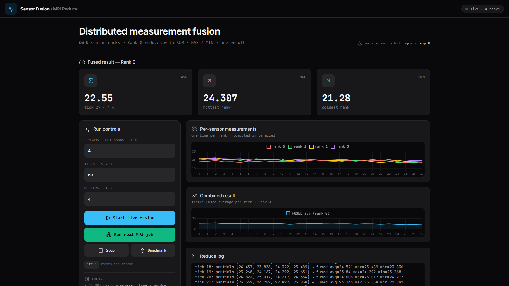
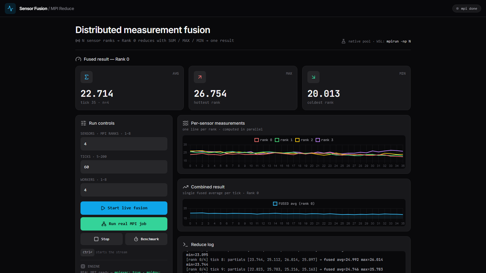
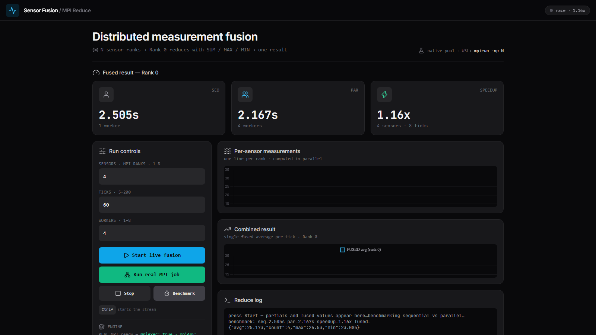

# Real-Time Distributed Measurement Fusion (Parallel Computing)

**Topic:** Combining distributed measurements into one result.
**Stack:** Python + MPI (`mpi4py`) + Flask SSE + Chart.js.
**Runs two ways:** native Windows TODAY (process-pool fallback) and proper MPI in WSL Ubuntu (graded path).

## 1. Quickstart — native Windows, REAL MPI (no Ubuntu needed)

```powershell
cd parallel-sensor-fusion
python -m pip install flask numpy mpi4py impi-rt
python app.py
# open http://127.0.0.1:5000
#  - "Start live fusion"  -> pool-mode live stream
#  - "Run real MPI job"   -> genuine mpiexec -n N run, Rank-0 rows in the log
#  - "Benchmark"          -> sequential vs parallel speedup
```

Headless MPI proof (shows in any terminal, no browser):

```powershell
& "$env:LOCALAPPDATA\Programs\Python\Python311\Library\bin\mpiexec.exe" -n 4 python sensor_mpi.py --ticks 5 --delay 0
# each line = Rank 0 MPI_Reduce SUM/MAX/MIN -> one fused avg/max/min
```

Benchmark proves parallelism:

```powershell
python -c "from sensor_core import run_sequential, run_parallel_pool; import time; t0=time.time(); run_sequential(4,10,heavy_iters=30000); s=time.time()-t0; t0=time.time(); run_parallel_pool(4,10,heavy_iters=30000); p=time.time()-t0; print(f'seq={s:.2f}s par={p:.2f}s speedup={s/p:.2f}x')"
```

## 2. Proper MPI — WSL Ubuntu (for grading)

You have no distro installed (`wsl -l -v` is empty). Install once:

```powershell
wsl --install -d Ubuntu-24.04
# reboot if asked, create Ubuntu username/password, then:
wsl -d Ubuntu-24.04
```

Inside Ubuntu:

```bash
cd /mnt/c/Users/unusu/parallel-sensor-fusion
bash wsl-setup.sh
# graded proof:
mpirun -np 4 python3 sensor_mpi.py --ticks 20
# each line = Rank 0 MPI_Reduce SUM/MAX/MIN -> one fused avg/max/min
```

Serve dashboard from WSL (optional — same UI):

```bash
python3 app.py
# open http://localhost:5000 on Windows
```

## 3. What to tell your professor (2 min)

1. Each MPI rank simulates one sensor node (`simulate_one_sensor` in `sensor_core.py:10`).
2. Every tick each rank computes locally in parallel (CPU-heavy filter).
3. `sensor_mpi.py` reduces with `comm.reduce(SUM/MAX/MIN)` + `comm.gather` — many values down to ONE result on Rank 0.
4. Dashboard shows per-sensor curves + single fused curve + event log + sequential-vs-parallel speedup.
5. If `mpiexec` is blocked in class, `/stream` fallback uses `ProcessPoolExecutor` — same math, never crashes.

## 4. Files

- `sensor_core.py` — simulation + `combine_measurements` (the reduction)
- `sensor_mpi.py` — MPI driver (Rank 0 prints JSON/tick)
- `app.py` — Flask + SSE `/stream`, `/api/benchmark`, `/api/mpi-run`, `/api/mpi-status`
- `templates/index.html` — dashboard (Tailwind + Lucide + Chart.js)
- `wsl-setup.sh` — Ubuntu MPICH + mpi4py installer
- `report/` — seminar report (`.docx`) + `build_report.py` / `verify_report.py` to regenerate it
- `report_shots/` — Playwright screenshots of the running app (also embedded in the report)

## 5. Screenshots




